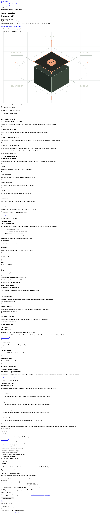

# Sikt – nettside med kontaktskjema

Komplett nettside for en liten tjenestevirksomhet: innholdssider, kontaktskjema med validering, ratebegrensning og personvernsider – bygget for å kunne deployes på Cloudflare.



> Design- og utviklingsprosjekt. «Sikt» er brukt som fiktivt firmanavn og har ingen tilknytning til en eksisterende virksomhet. Siden er ikke deployet, og `draft: true` er beholdt med vilje – se [Hvorfor det står TODO](#hvorfor-det-står-todo).

## Hva den inneholder

- Seks sider: forside, kontakt, personvern, informasjonskapsler, takk og feilside
- Kontaktskjema med server-side validering og ratebegrensning per IP
- Cloudflare Pages Functions som backend, D1 som datalager
- Automatisk sjekk av bygg, sider, lokale ressurser og sikkerhetsheadere
- Juridiske sider som holder seg unna påstander den ikke kan dokumentere

## Teknisk

| | |
|---|---|
| Rammeverk | Astro |
| Språk | TypeScript |
| Styling | Tailwind CSS |
| Backend | Cloudflare Pages Functions + D1 |
| E-post | Resend (ikke tilkoblet) |
| Tester | Playwright, `node --test`, Lighthouse-skript |

```
functions/api/contact.ts   → validering, honeypot, ratebegrensning
migrations/               → D1-skjema for ratebegrensning
scripts/                  → check-build, launch-check, browser-check, lighthouse
```

## Kom i gang

```sh
npm install
npm run dev
```

Miljøvariabler for skjemaet ligger i [`.dev.vars.example`](.dev.vars.example). Uten dem kjører sidene fint, men innsending gjør ingenting.

## Testing

Typekontroll: 0 feil, 0 advarsler. 10 av 10 tester for kontaktskjemaet består, og bygging er kjørt. `test:site` sjekker seks sider, lokale ressurser og genererte headere. Den bygde siden lastet uten JavaScript-feil. Detaljer i [`VERIFISERING.md`](VERIFISERING.md).

## Hvorfor det står TODO

Feltene i `src/data/site.json` og de juridiske sidene inneholder bevisst `[TODO: …]` i stedet for oppdiktede opplysninger. Et organisasjonsnummer, en behandlingsansvarlig og en personvernkontakt er ikke noe man fyller inn med placeholder-verdier – det må være sant for at teksten skal ha verdi.

`scripts/launch-check.mjs` feiler hvis slike verdier står igjen, og `draft: true` hindrer indeksering. Det betyr at siden ikke kan publiseres ved et uhell før opplysningene er reelle. D1 og Resend er ikke tilkoblet, og produksjonsmiljøet er ikke testet.

## Lisens

MIT for koden i dette repoet – se [LICENSE](LICENSE). Skrifttypen Manrope brukes under SIL Open Font License, se `public/licenses/`.
